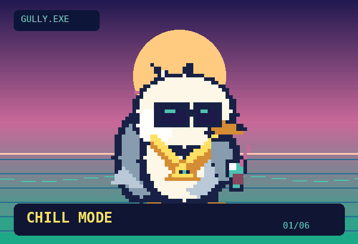

# 🐦 GOOD GOLLY, HE'S GULLY

**An animated, gold-chained beach-bum seagull companion for Codex.**



Devin's original concept, personality, and lore remain in `pets/gully/`. This upgrade replaces the placeholder sprite art and broken install assumptions with a deterministic, dependency-free **nine-state / 57-frame** animated atlas, a neon beach preview, real package validation, and a cross-platform installer.

## Quick start (Node.js 20+)

```bash
git clone https://github.com/AlexBaldman/gully-codex-pet.git
cd gully-codex-pet
npm run preview
```

Open **http://127.0.0.1:4173**. Click any of the nine states, press `1`–`9`, pause, or download the complete transparent sprite sheet. The preview automatically generates the sprite asset on startup. No image API keys, ImageMagick, dependencies, or external services required.

## Install in Codex

```bash
npm run install-pet
```

This creates and validates the correct **1536×1872 transparent PNG** and installs exactly these files:

```text
${CODEX_HOME:-~/.codex}/pets/gully/
  pet.json
  spritesheet.png
```

Then in the Codex desktop app open **Settings → Pets → Refresh** and select **Good Golly He's Gully**. The app's pet support and UI placement depend on your version/account. CLI users can try `/pets` in a supported terminal.

The manifest follows [OpenAI's hatch-pet contract](https://github.com/openai/skills/blob/main/skills/.curated/hatch-pet/references/codex-pet-contract.md). Pet IDs, names, and file paths are standardized; character lore is deliberately kept in separate docs rather than placed into unrecognized manifest keys.

## Dev commands

| Command | What it actually does |
| --- | --- |
| `npm run preview` | Serves a working, interactive browser pet lab on localhost |
| `npm run build` | Produces `pets/gully/spritesheet.png` from deterministic source code |
| `npm run validate` | Checks manifest, PNG dimensions, transparency, populated and empty slots |
| `npm test` | Tests all 9 animation rows, frame differences, and PNG encoding |
| `npm run install-pet` | Builds, validates, and copies the pet to Codex's local pet directory |
| `npm run full-workflow` | Builds, validates, installs, and tests |

## Codex animation contract

| Row | State | Frames | Meaning |
|---|---|---:|---|
| 0 | idle | 6 | Breathing, resting |
| 1 | running-right | 8 | Drifting right |
| 2 | running-left | 8 | Drifting left |
| 3 | waving | 4 | Saying hello |
| 4 | jumping | 5 | Celebrating |
| 5 | failed | 8 | Deflated after an error |
| 6 | waiting | 6 | Approval or user input needed |
| 7 | running | 6 | Actively working, **not** literally running |
| 8 | review | 6 | Inspecting the result |

Cells are 192×208, eight columns across, transparent outside the art. **Unused trailing cells must have zero alpha.** This is different from the original five-row layout and green-screen placeholder. The sprite is drawn natively at 48×52 and upscaled 4× using nearest-neighbor pixels.

## Creative direction

Dark sunglasses, orange beak, disheveled white-and-gray feathers, an absurd gold pyramid pendant, and a highly suspect tropical beverage: Gully has the swagger of a gull who has never paid rent, yet feels qualified to lead standup. His home is the Really Long Beach / JeoPARODY universe. The procedural pixel look is a functional first playable version, deliberately easy to replace or extend with handcrafted image-gen art later.

Preserved source documents: [character lore](pets/gully/GULLY_LORE.md) and [visual prompts](pets/gully/art-prompts.md). The earlier `scripts/*.sh` generation/assembly scripts remain as historical references; **use the new `npm run` workflows** above.

## Known limits

- This repository creates **a local Codex pet**, not an autonomous event stream for other apps. Animation state changes are controlled by Codex when installed. The browser preview provides manual state switching for testing.
- The sprite's pixel-art design is functional but should still be reviewed visually at 64–128px sizes before broader distribution.
- Installation cannot be verified against a remote Codex desktop instance; it must be selected on a local machine.

MIT licensed. Built for very serious software engineering. Allegedly.
